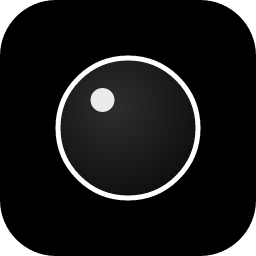

     
    <h1>Bubble</h1>
    <h3>Just a bubble on top of your monitor</h3>

## Using
Right now there is nothing special in this app, it's just a base for other many functions.
Bubble can only show time and date.

## Preview

    

